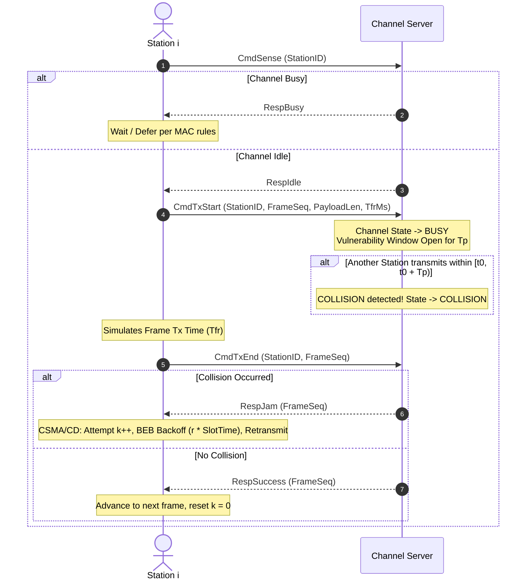
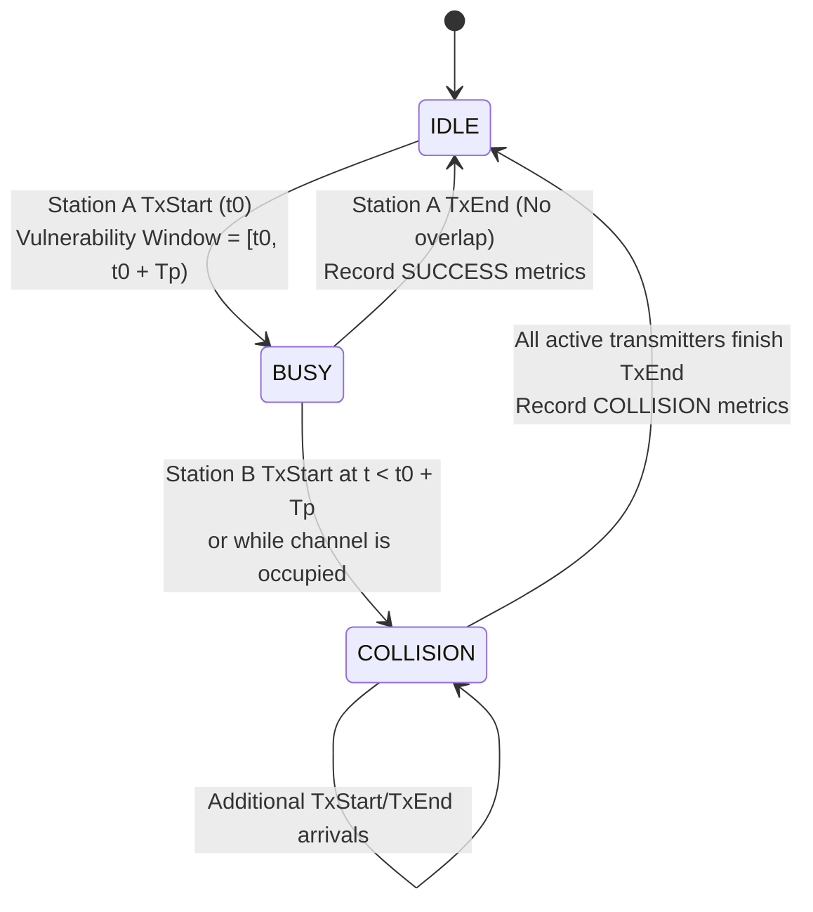

# CSMA & CSMA/CD Simulation — Architecture & Implementation Plan
**Course:** Computer Networks (Assignment 3)  
**System Architecture:** Client-Server Multi-Access Channel Simulation  
**Implementation Stack:** Go (1.22+), Bash, Python 3 (Matplotlib, NumPy)

---

## 1. Executive Summary & Problem Scope

The objective of Assignment 3 is to design, implement, and benchmark a high-fidelity simulation of **Carrier Sense Multiple Access (CSMA)** and **Carrier Sense Multiple Access with Collision Detection (CSMA/CD)** in Go.

The simulation models a shared multi-access broadcast medium where $N$ independent stations compete for access to a central channel governed by physical transmission constraints:
* **Carrier Sensing:** Stations can probe channel status before transmitting.
* **Vulnerability Period ($T_p$):** Due to finite propagation delay $T_p$, transmissions starting within $T_p$ of an ongoing transmission collide.
* **Collision Detection & Backoff ($T_{fr} \ge 2 T_p$):** Stations running CSMA/CD detect collisions during frame transmission and execute **Binary Exponential Backoff (BEB)** up to 16 retries.
* **Pure CSMA Protocols:** Non-Persistent, 1-Persistent, and p-Persistent schemes operate in fire-and-forget mode.

---

## 2. Theoretical Foundations & Mathematical Model

### 2.1 Propagation Delay ($T_p$) and the Vulnerability Window
In a bus topology of length $L$ with propagation speed $v$, the one-way propagation delay is:
$$T_p = \frac{L}{v}$$

When Station A begins transmitting at time $t_0$, its signal takes $T_p$ time to reach the farthest end of the channel. During the interval $[t_0, t_0 + T_p)$, any other station sensing the channel will perceive it as **IDLE**. If Station B initiates transmission during this window, a **collision** occurs.

```
Station A:  |--- Tx Start (t0) ----------------------------------->
            [=== Vulnerability Window: [t0, t0 + Tp) ===]
Station B:      |--- Senses IDLE at (t0 + 0.5 Tp) -> Transmits -> COLLISION!
```

### 2.2 The Collision Detection Condition: $T_{fr} \ge 2 T_p$
For a station to detect that its transmission collided before it finishes sending, the minimum frame duration $T_{fr}$ must satisfy:
$$T_{fr} \ge 2 T_p$$

**Key Architectural Insight:**  
Because $T_{fr} \ge 2 T_p$, any collision that can possibly occur happens within the first $T_p$ of transmission, and the collision signal reaches all transmitters by at most $2 T_p \le T_{fr}$.  
Therefore, the Channel Server can **synchronously determine the transmission outcome** (`RespSuccess` or `RespJam`) and return the verdict to the station upon completion of $T_{fr}$. This completely eliminates race conditions and avoids complex asynchronous background listening threads on the station side.

### 2.3 Binary Exponential Backoff (BEB)
For CSMA/CD, on collision attempt $k \in [1, 16]$:
1. Compute backoff exponent:
   $$m = \min(k, 10)$$
2. Draw backoff slot count uniformly at random:
   $$r \sim \mathcal{U}\left(0, 2^m - 1\right)$$
3. Compute backoff wait duration:
   $$\text{BackoffTime} = r \times \text{SlotTime} \quad \text{where } \text{SlotTime} = 2 T_p$$
4. After waiting, the station resumes 1-persistent carrier sensing.
5. If $k > 16$, the station aborts the frame (excessive collision drop) and moves to the next frame.

### 2.4 Performance & Evaluation Metrics
* **Throughput ($S$):**
  $$S = \frac{\text{Total Successfully Delivered Payload Bits}}{\text{Total Simulation Duration (seconds)}} \quad \text{[bps or kbps]}$$
* **Channel Efficiency ($\eta$):**
  $$\eta = \frac{\sum T_{fr}(\text{successful frames})}{\text{Total Simulation Wall Time}} \times 100\%$$
* **Collision Rate ($C_{\text{rate}}$):**
  $$C_{\text{rate}} = \frac{\text{Total Collision Episodes}}{\text{Total Frame Transmission Attempts}}$$
* **Packet Delivery Ratio (PDR):**
  $$\text{PDR} = \frac{\text{Total Successful Frames}}{\text{Total Unique Frames Generated}} \times 100\%$$

---

## 3. System Architecture & Topology

```
+-------------------------------------------------------------------------------+
|                             CHANNEL SERVER                                    |
|  - Channel State Machine (IDLE, BUSY, COLLISION)                              |
|  - Physical Channel Emulation (Tp Vulnerability Window, Tfr duration)         |
|  - Thread-Safe Event Synchronizer & Collision Logger                          |
|  - Real-Time Live Console Dashboard & Metrics Aggregator                      |
+-------------------------------------------------------------------------------+
              ^                                  ^                  ^
              | (TCP Socket)                     | (TCP Socket)     | (TCP Socket)
              v                                  v                  v
    +-------------------+              +-------------------+      +-------------------+
    |     Station 1     |              |     Station 2     |      |     Station N     |
    |  - Frame Queue    |              |  - Frame Queue    |      |  - Frame Queue    |
    |  - Carrier Sense  |              |  - Carrier Sense  |      |  - Carrier Sense  |
    |  - MAC Engine:    |              |  - MAC Engine:    |      |  - MAC Engine:    |
    |    * Non-Persist  |              |    * Non-Persist  |      |    * Non-Persist  |
    |    * 1-Persist    |              |    * 1-Persist    |      |    * 1-Persist    |
    |    * p-Persist    |              |    * p-Persist    |      |    * p-Persist    |
    |    * CSMA/CD+BEB  |              |    * CSMA/CD+BEB  |      |    * CSMA/CD+BEB  |
    +-------------------+              +-------------------+      +-------------------+
```

---

## 4. Sequence & State Flow

### 4.1 Transmission Sequence Diagram (CSMA/CD)



### 4.2 Channel Server State Machine



---

## 5. Detailed Wire Protocol Specification

Communication occurs over standard TCP connections using framed binary packets with 1-byte opcodes and fixed-length structures.

### 5.1 Protocol Opcodes

| Opcode | Name | Direction | Payload Structure | Description |
| :---: | :--- | :---: | :--- | :--- |
| `0x01` | `CmdSense` | Station $\to$ Server | `StationID: uint16` | Station queries current channel state |
| `0x02` | `RespIdle` | Server $\to$ Station | `Reserved: uint8` | Channel is perceived as IDLE |
| `0x03` | `RespBusy` | Server $\to$ Station | `Reserved: uint8` | Channel is perceived as BUSY |
| `0x10` | `CmdTxStart` | Station $\to$ Server | `StationID: uint16`<br/>`FrameSeq: uint32`<br/>`PayloadLen: uint16`<br/>`TfrMs: uint32` | Station declares transmission beginning |
| `0x11` | `CmdTxEnd` | Station $\to$ Server | `StationID: uint16`<br/>`FrameSeq: uint32` | Station declares transmission completion |
| `0x20` | `RespSuccess` | Server $\to$ Station | `FrameSeq: uint32`<br/>`TotalCollisions: uint32` | Frame transmitted successfully |
| `0x21` | `RespJam` | Server $\to$ Station | `FrameSeq: uint32`<br/>`CollisionCount: uint32` | Collision detected on frame |

---

## 6. MAC Algorithm Specifications

### 6.1 Non-Persistent CSMA
```
1. Sense channel (CmdSense)
2. If channel is BUSY:
   - Wait random backoff delay: t_wait = Uniform(1, 5) * SlotTime
   - Go to step 1
3. If channel is IDLE:
   - Send CmdTxStart
   - Sleep T_fr (simulate wire transmission)
   - Send CmdTxEnd
   - Read Server Response (RespSuccess / RespJam)
   - Log outcome (Fire-and-forget: do not retransmit on jam)
   - Wait Inter-Frame Gap (IFG) and advance to next frame
```

### 6.2 1-Persistent CSMA
```
1. Sense channel (CmdSense)
2. If channel is BUSY:
   - Sleep polling interval (e.g., 0.5 ms)
   - Go to step 1 (keep sensing continuously)
3. If channel is IDLE:
   - Transmit immediately (CmdTxStart -> Sleep T_fr -> CmdTxEnd)
   - Read Server Response (Fire-and-forget)
   - Wait IFG and advance to next frame
```

### 6.3 p-Persistent CSMA
```
1. Sense channel until IDLE (continuous sensing)
2. When IDLE:
   - Generate random float u ~ Uniform(0, 1)
   - If u <= p:
     * Transmit immediately (CmdTxStart -> Sleep T_fr -> CmdTxEnd)
     * Read Server Response (Fire-and-forget)
     * Wait IFG and advance to next frame
   - If u > p:
     * Wait 1 SlotTime (2 * Tp)
     * Re-sense channel:
       - If IDLE: repeat step 2
       - If BUSY: treat as deferred, wait until IDLE again (step 1)
```

### 6.4 CSMA/CD with Binary Exponential Backoff (BEB)
```
1. For each frame, set attempt counter k = 0:
2. Loop:
   a. 1-Persistent Sense: wait until channel is IDLE
   b. Send CmdTxStart
   c. Sleep T_fr (wire transmission)
   d. Send CmdTxEnd
   e. Read Server Response:
      - If RespSuccess:
          Log success
          k = 0
          Break loop -> advance to next frame
      - If RespJam:
          k = k + 1
          If k > 16:
              Log "Frame Dropped: Excessive Collisions (16)"
              Break loop -> abort frame, advance to next frame
          Else:
              m = min(k, 10)
              r = UniformInt(0, 2^m - 1)
              Wait r * SlotTime
              Continue loop (retransmit current frame)
```

---

## 7. Directory Structure & Codebase Organization

```
ass3/
├── go.mod                     # Go module definition (go 1.22)
├── ARCHITECTURE.md            # In-repo copy of this master plan
├── common/
│   ├── protocol.go            # Binary messages, opcodes, serialization & constants
│   ├── frame.go               # Frame headers, generation, and validation
│   └── metrics.go             # Data structures for station and server metrics, CSV writer
├── server/
│   ├── channel.go             # Thread-safe Channel state machine, Tp vulnerability logic
│   ├── server.go              # TCP listener, per-station connection workers
│   └── main.go                # Server entry point CLI (-port, -tp, -log-level)
├── station/
│   ├── station.go             # Station connection, state, frame loop
│   ├── mac_csma.go            # Non-persistent, 1-persistent, p-persistent implementations
│   ├── mac_csmacd.go          # CSMA/CD implementation with BEB logic
│   └── main.go                # Station CLI (-id, -mode, -frames, -p, -server)
├── sim/
│   ├── orchestrator.go        # Programmatic concurrent simulation runner (server + N stations)
│   └── main.go                # Orchestrator CLI (-n, -mode, -frames, -tp, -tfr, -out)
└── eval/
    ├── run_eval.sh            # Automated batch benchmarks across modes and station counts
    ├── plot.py                # Graph generator: Throughput, Efficiency, Collisions, Success Rate
    └── results.csv            # Consolidated benchmark output data
```

---

## 8. Phased Implementation Roadmap

### Phase 1: Common Types, Protocol & Serialization (`common/`)
* [x] Design message framing and wire opcodes.
* [ ] Implement `common/protocol.go`:
  * Binary encode/decode routines with `io.ReadFull` and byte buffers.
  * Constants: $T_p = 5\text{ms}$, $T_{fr} = 10\text{ms}$, $\text{SlotTime} = 2 T_p = 10\text{ms}$, $\text{IFG} = 2\text{ms}$.
* [ ] Implement `common/metrics.go`:
  * Summary structures for throughput, efficiency, collisions, and CSV export.

### Phase 2: Central Channel Server (`server/`)
* [ ] Implement `server/channel.go`:
  * Thread-safe channel state machine (`IDLE`, `BUSY`, `COLLISION`).
  * Vulnerability window tracking using high-resolution monotonic timestamps (`time.Now()`).
  * Collision detection logic:
    * If Station $X$ starts within $T_p$ of Station $Y$, both are flagged as collided.
    * If Station $X$ starts while channel is already $BUSY$ ($t \ge t_0 + T_p$), immediate collision.
* [ ] Implement `server/server.go`:
  * TCP listener accepting connections from multiple stations concurrently.
  * Synchronous request handling: responds to `CmdSense`, records `CmdTxStart`, evaluates outcome at `CmdTxEnd`.
* [ ] Implement `server/main.go`:
  * Clean CLI with flags (`-port`, `-tp`).
  * Pretty-printed ASCII summary upon simulation completion.

### Phase 3: Station MAC Engine (`station/`)
* [ ] Implement `station/station.go`:
  * TCP client with socket reconnect/connection handling.
  * Frame generator producing fixed payload size (e.g., 64 bytes).
* [ ] Implement `station/mac_csma.go`:
  * `RunNonPersistent(ctx)`
  * `Run1Persistent(ctx)`
  * `RunPPersistent(ctx, p)`
* [ ] Implement `station/mac_csmacd.go`:
  * `RunCSMACD(ctx)` with Binary Exponential Backoff (BEB).
  * Frame retransmission buffer and collision counter (max 16).
* [ ] Implement `station/main.go`:
  * Standalone CLI to launch a single station for interactive manual testing.

### Phase 4: Programmatic Simulation Orchestrator (`sim/`)
* [ ] Implement `sim/orchestrator.go`:
  * Can launch the Channel Server and $N$ station goroutines in a single Go process.
  * Synchronizes station start times using a barrier/countdown latch.
  * Waits for all stations to finish transmitting their frame quota.
  * Automatically collects channel metrics and writes rows to `eval/results.csv`.
* [ ] Implement `sim/main.go`:
  * CLI tool: `go run ./sim -stations 8 -mode csma-cd -frames 50 -tp 5ms -tfr 10ms`.

### Phase 5: Evaluation & Visualization Suite (`eval/`)
* [ ] Implement `eval/run_eval.sh`:
  * Sweeps station counts: $N \in \{2, 4, 6, 8, 12, 16, 20\}$.
  * Sweeps MAC modes: `non-persistent`, `1-persistent`, `p-persistent` ($p=0.2$, $p=0.5$), `csma-cd`.
  * Repeats runs to obtain stable averages.
* [ ] Implement `eval/plot.py`:
  * Generates 4 publication-quality plots:
    1. **Throughput (kbps) vs Station Count ($N$)**
    2. **Channel Efficiency (%) vs Station Count ($N$)**
    3. **Total Collisions vs Station Count ($N$)**
    4. **Frame Success Delivery Rate (%) vs Station Count ($N$)**
  * Saves high-resolution figures in `eval/plots/`.

### Phase 6: End-to-End Verification & Validation
* [ ] Unit test: Verify $T_p$ vulnerability window collision trigger.
* [ ] Unit test: Verify BEB backoff distribution bounds ($2^{\min(k,10)} - 1$).
* [ ] Integration test: Confirm CSMA/CD achieves higher throughput and fewer wasted channel cycles than pure 1-persistent CSMA under heavy contention.
* [ ] Export benchmark graphs and generate `eval/analysis_report.md`.

---

## 9. Verification & Acceptance Criteria

| Protocol | Expected Contention Behavior | Expected Relative Throughput under High Load |
| :--- | :--- | :--- |
| **1-Persistent** | Severe collisions when channel frees up and multiple stations queue. | **Lowest** (collides frequently, no backoff, no retx) |
| **Non-Persistent** | Lower collision rate due to random backoff on busy sense, but higher idle gaps. | **Moderate** |
| **p-Persistent** | Tunes collision vs delay trade-off using parameter $p$. | **Moderate to High** (optimal at small $p$) |
| **CSMA/CD** | Detects collisions early, retries with BEB, achieving optimal channel utilization. | **Highest** (recovers frames, adaptive backoff) |
